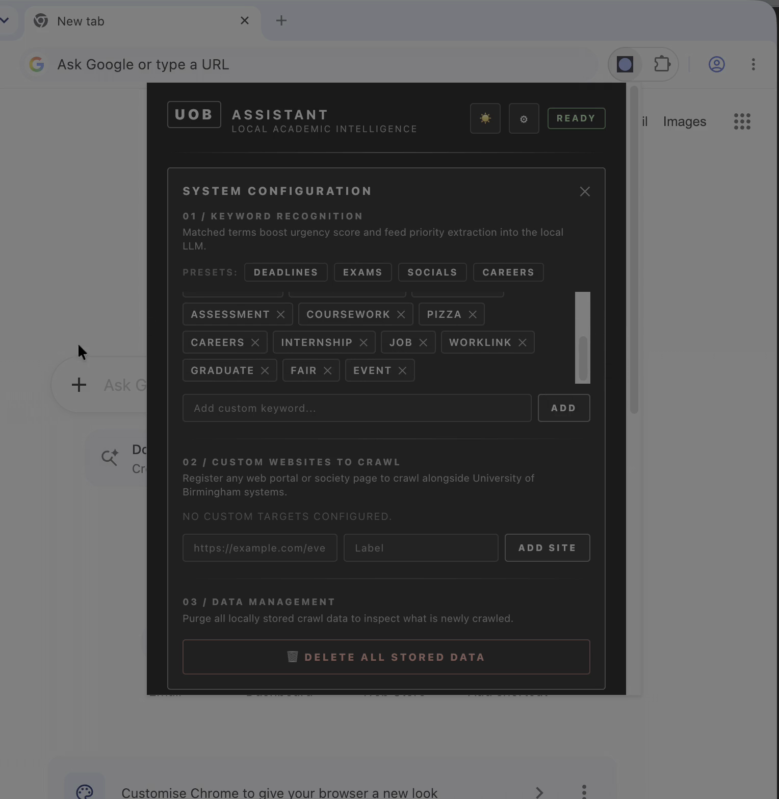
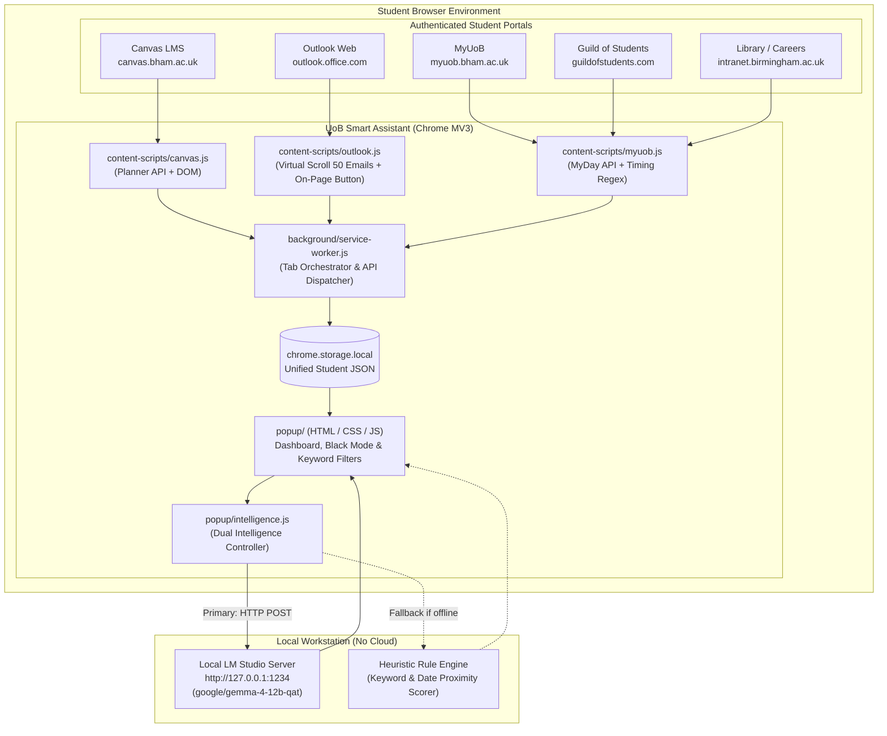

# UoB Smart Assistant

> **Winner (1st Place out of 12 Teams)** at the **Accenture X Builders Club Hackathon** (October 2026, University of Birmingham).

An intelligent, local-first Chromium extension that eliminates student notification fatigue by aggregating deadlines, notices, timetables, and campus events across **Canvas**, **Outlook**, **MyUoB**, **Guild Societies**, and **Library Services**—synthesizing them into an actionable daily briefing using an on-device Large Language Model (**Google Gemma 4 12B**).

---

## 🎬 Product Demo in Action

<!-- Full interactive video player with controls -->
  <video src="https://github.com/user-attachments/assets/c96bbea6-08fd-43e8-ade1-79a28d3230c8" controls="controls" width="100%" style="max-width: 820px; border-radius: 8px; border: 1px solid rgba(255, 255, 255, 0.15);">
    <a href="https://github.com/user-attachments/assets/c96bbea6-08fd-43e8-ade1-79a28d3230c8">
      
    </a>
  </video>
---

## 📑 Table of Contents
1. [Product Demo in Action](#-product-demo-in-action)
2. [The Problem: Student Notification Fatigue](#-the-problem-student-notification-fatigue)
3. [What the Extension Does](#-what-the-extension-does)
4. [Architecture & Data Flow](#-architecture--data-flow)
5. [Our Iterative Engineering Journey](#-our-iterative-engineering-journey)
6. [Key Technical Challenges & How We Solved Them](#-key-technical-challenges--how-we-solved-them)
7. [How the Extension Could Be Improved (Future Roadmap)](#-how-the-extension-could-be-improved-future-roadmap)
8. [Installation & Quick Start](#-installation--quick-start)
9. [Running the Local AI Engine](#-running-the-local-ai-engine)
10. [Project Structure](#-project-structure)

---

## 🚨 The Problem: Student Notification Fatigue

University students are overwhelmed by fragmented digital platforms:
- **Canvas LMS**: Coursework assignments, mid-term quizzes, discussion boards, and rubric changes.
- **Outlook Web (Exchange/Office 365)**: Hundreds of departmental emails, sudden lecture hall changes, feedback notifications, and administrative deadlines.
- **MyUoB (MyDay Cloud)**: Timetables, campus announcements, and university service alerts.
- **Guild of Students**: Society meetings, hackathons, guest talks, and social events.
- **FindIt@Bham (Library)**: Book return dates and study space reservations.

Important academic deadlines get buried in email threads, students miss room change announcements, and finding work-life balance is difficult.

Most existing aggregator tools either rely on paid proprietary cloud services or harvest sensitive academic credentials. We engineered **UoB Smart Assistant** to be **100% private, on-device, and zero-cloud**: your data never leaves your machine.

---

---

## ✨ What the Extension Does

### 1. Multi-Portal Hybrid Crawling
- **Canvas LMS**: Queries the official authenticated Canvas Planner REST API (`/api/v1/planner/items`) using the browser's active session cookies, with an automatic fallback to DOM scraping. Converts relative Canvas API URLs into direct absolute links.
- **Outlook Web (CodeURJC Architecture)**: Re-engineered using the battle-tested strategy of [`codeurjc/outlook-scraper`](https://github.com/codeurjc/outlook-scraper). The service worker intercepts live `Authorization: Bearer <token>` and `X-AnchorMailbox` headers on `/owa/service.svc` using `chrome.webRequest.onBeforeSendHeaders` (with `extraHeaders`). It calls OWA's internal `FindItem` JSON API with standard EWS schemas (`item:Subject`, `item:DateTimeReceived`, `item:Preview`, etc.) to retrieve up to **50 recent emails** instantly. If the API is unreachable, an ultra-resilient multi-selector virtual-scroll DOM crawler takes over automatically.
- **MyUoB & Guild Societies**: Interfaces with the `api.myday.cloud` REST endpoints for personal timetables and scrapes the Guild of Students website using a precision timing parser (`parseTimes`) for recurring days and time slots (e.g., `Starts 19:00 - 21:00`).
- **Library & Careers**: Tracks book return deadlines (to avoid overdue fines) and student employment deadlines via Careers Connect.
- **🌐 User-Added Custom Websites**: Enables students to register custom sites (departmental wikis, external course blogs, project portals) in Settings. A dedicated semantic extractor (`content-scripts/custom.js`) extracts headings, dates, urgency signals, and source links.

### 2. Direct Source Verification (`PROOF ↗`)
- Every aggregated card across Canvas, Outlook, societies, and custom portals includes a direct **`PROOF ↗`** action button.
- Clicking it immediately takes the student to the exact URL where the information originated (e.g. direct Canvas assignment page, specific Outlook message thread `/mail/id/...`, or society event page) instead of a broken extension URL or generic portal root.

### 3. Dual-Engine Intelligence
- **Primary AI (On-Device via LM Studio)**: Connects to a local instance of `google/gemma-4-12b-qat` running on `http://127.0.0.1:1234/v1/chat/completions`. It performs structured JSON synthesis without sending any student data over the internet:
  - **Academic Crunch Summary**: A concise 2-sentence breakdown of upcoming workload peaks.
  - **Top 3 Urgent Priorities**: Actionable, high-impact items with specific urgency reasons.
  - **Campus & Society Pulse**: Work-life balance recommendations (socials, pizza nights, hackathons).
- **Heuristic Fallback Engine**: If the local LLM is offline or busy, a built-in rule engine immediately scores items based on deadline proximity and urgency keywords (`exam`, `due`, `submission`, `coursework`, `urgent`), ensuring the dashboard **never crashes or freezes**.

### 4. Falter Inferno Aesthetic & UI
- **Brutalist, High-Contrast Design**: Redesigned after the stark, minimalist aesthetic of `falter.wild.plus`—pure obsidian backgrounds (`#0d0d0d`), razor-sharp white borders (`rgba(255,255,255,0.15)`), monospaced status labels, uppercase tracking, and clean zero-clutter typography.
- **🔍 Instant Keyword Search**: Live filtering across all aggregated items (by subject, module code, sender, or snippet).
- **⚙️ Slide-Down Configuration Drawer**:
  - **01 / AI MODEL & PROMPT CONFIG**: Fine-tune local model endpoints, timeouts, and urgency keywords.
  - **02 / CUSTOM TARGETS**: Add, inspect, and remove custom URLs to be crawled during portal syncs.
  - **03 / DATA MANAGEMENT**: Cleanly wipe local caches for clean crawls without cluttering the main dashboard.


---

## 🏗 Architecture & Data Flow



---

## 🔄 Our Iterative Engineering Journey

During the 3-hour hackathon, we followed an agile, iterative engineering strategy:

```
┌─────────────────┐     ┌─────────────────┐     ┌─────────────────┐     ┌─────────────────┐     ┌─────────────────┐
│   Iteration 1   │     │   Iteration 2   │     │   Iteration 3   │     │   Iteration 4   │     │   Iteration 5   │
│ Isolated PoCs   │ ──► │ Parallel Tracks │ ──► │ Unified Arch    │ ──► │ Bug Squashing   │ ──► │ Production Win  │
│ (Outlook Script)│     │ (Canvas/Soc/AI) │     │ (MV3 Extension) │     │ (Async/Scroll)  │     │ (Gemma 4 + Demo)│
└─────────────────┘     └─────────────────┘     └─────────────────┘     └─────────────────┘     └─────────────────┘
```

### Iteration 1: The First Proof of Concept
- Started with a minimal Outlook DOM scraper (`outlook-today-crawler`) that parsed visible emails from `outlook.cloud.microsoft` and exported a local JSON file.
- Built a standalone Node.js script (`backend-processor.js`) that verified local LLM integration via prompt engineering and unit tests (`test/backend-processor.test.js`).

### Iteration 2: Parallel Specialization & Git Discipline
- Rather than working in a single messy branch, we divided into specialized feature branches:
  - **`origin/OutlookCrawler`**: Focused on Outlook DOM extraction and field parsing.
  - **`origin/extension`**: Investigated official Canvas LMS Planner APIs and MyDay Cloud endpoints.
  - **`origin/SocCrawler`**: Engineered a recurring meeting and timing parser (`parseTimes`) for student society schedules.
- **The Team Catalyst**: Enforcing Git hygiene (clean commits and remote tracking) prevented merge conflicts and enabled rapid parallel development under strict time limits.

### Iteration 3: Convergence on `UOB-Palentir-1`
- Merged all individual scripts into a unified Chromium Manifest V3 architecture.
- Replaced the standalone Node server with in-extension execution: the background service worker orchestrates background tabs, injects content scripts, collects results, and stores unified JSON directly into `chrome.storage.local`.
- Built the initial popup UI with Birmingham branding and student-friendly views.

### Iteration 4: Debugging Critical Edge Cases
- Discovered and resolved three major technical bottlenecks:
  1. Synchronous execution dropping async Promises in `chrome.scripting.executeScript`.
  2. Virtualized DOM rendering in Outlook cutting off emails after 10–15 items.
  3. Client disconnection timeouts in LM Studio during heavy prompt evaluations.

### Iteration 5: Polish, Local AI Optimization & Winning
- Switched from a heavy 27B model to `google/gemma-4-12b-qat`, extending client timeouts to 120s and compacting prompt tokens for sub-4-second evaluations.
- Added True Black Mode, interactive keyword presets, floating on-page extraction buttons, and a clean data reset button.
- Pitched the live working prototype to the judges, securing **1st Place** among 12 competing teams.

---

## 🛠 Key Technical Challenges & How We Solved Them

### 1. The Async Execution Promise Bug
- **Symptom**: The service worker's `crawlTab` was returning `{}` or empty arrays for Canvas and Outlook even though the scrapers ran without errors.
- **Root Cause**: `chrome.scripting.executeScript` executed a synchronous wrapper (`func: (fnName) => window[fnName]()`). Because modern crawlers must `await` network calls or DOM renders, `window[fnName]()` returned a Promise, which failed `Array.isArray(res)` and serialized as empty.
- **Solution**: Updated `executeScript` to use an `async` function that explicitly `await`s `window[fnName]()`:
  ```javascript
  func: async (fnName, sourceName) => {
    if (typeof window[fnName] === "function") {
      const res = await window[fnName]();
      return Array.isArray(res) ? res.map(i => ({ ...i, source: i.source || sourceName })) : res;
    }
    return [];
  }
  ```

### 2. Outlook's Auth Closure & The 50-Email Requirement
- **Symptom**: Microsoft Outlook Web does not store MSAL Bearer tokens in `localStorage` or `sessionStorage` (they are kept in an in-memory JS closure), and unauthenticated calls to `/owa/service.svc` are rejected. Furthermore, standard DOM scraping alone (`querySelectorAll('[role="option"]')`) is fragile because React Fluent UI virtualizes the list and unmounts off-screen emails after 10–15 rows.
- **Solution**: Inspired by [`codeurjc/outlook-scraper`](https://github.com/codeurjc/outlook-scraper), we implemented a multi-stage approach:
  1. The background service worker intercepts live Outlook network traffic via `chrome.webRequest.onBeforeSendHeaders` (specifically including `extraHeaders` so Chrome does not withhold the `Authorization` header), capturing the genuine `Bearer <token>` and `X-AnchorMailbox`.
  2. Tokens are persisted to `chrome.storage.local` to survive Manifest V3 service worker idle shutdowns.
  3. The content script calls OWA's internal `FindItem` JSON API with EWS schemas (`item:Subject`, `item:DateTimeReceived`, `item:Preview`, `message:From`), fetching up to 50 emails in one fast, reliable request.
  4. If the API is not yet warmed up or token capture is pending, an ultra-resilient multi-selector virtual-scroll DOM crawler (`content-scripts/outlook.js`) triggers programmatic wheel events and `scrollIntoView` to safely extract visible items.

### 3. SSO & Auth Bounces in Background Tabs
- **Symptom**: Opening a background tab to `outlook.cloud.microsoft` would frequently bounce between Microsoft login redirects or trigger 2FA prompts.
- **Solution**: Implemented **Active Tab Detection & Reuse**. The crawler checks `chrome.tabs.query` first: if the student already has an authenticated Outlook or Canvas tab open, it executes directly inside that tab with zero redirect delay, leaving the user's tab open when complete.

### 4. AI Disconnects & Model Selection
- **Symptom**: LM Studio logs showed `Client disconnected. Stopping generation...` at exactly 25 seconds.
- **Root Cause**: The 27B parameter model was spending 24+ seconds on prompt evaluation and reasoning tokens. The extension's `AbortController` had a 25-second limit, cutting off the connection before the first content token was returned.
- **Solution**:
  - Switched model to **`google/gemma-4-12b-qat`** (12B QAT), which evaluates prompts much faster.
  - Increased fetch timeout to **120 seconds**.
  - Optimized the prompt payload to pass only the top 8 urgent items with 100-character snippet caps.

---

## 🚀 How the Extension Could Be Improved (Future Roadmap)

While the hackathon prototype won 1st place, several enhancements would make it a commercial-grade personal assistant:

### 1. Bi-directional Calendar Synchronization
- **Current**: Deadlines and timetables are viewed within the extension popup.
- **Improvement**: Generate an authenticated `.ics` feed or use the Google Calendar / Apple Calendar API to sync scraped deadlines directly to the student's personal calendar.

### 2. Background Alarms & Push Notifications
- **Current**: Urgency tags (`Due in 14h`) appear when opening the extension.
- **Improvement**: Use `chrome.alarms` and `chrome.notifications` to fire proactive system alerts 24 hours and 2 hours before high-weight assignment deadlines.

### 3. Direct Microsoft Graph & Canvas OAuth Tokens
- **Current**: Scrapes DOM and uses session cookies via content scripts.
- **Improvement**: Implement an optional OAuth2 flow requesting `Mail.Read` and Canvas API tokens. This would allow silent background synchronization without needing to open tabs or render web pages.

### 4. Multi-Modal Coursework Digest
- **Current**: Extracts text snippets and assignment titles.
- **Improvement**: Feed assignment brief PDFs or rubric attachments to a local Vision-Language Model (VLM) to automatically generate checklist items and required deliverables for complex projects.

### 5. Cross-Browser Distribution
- **Current**: Packed for Chromium (Chrome, Brave, Edge).
- **Improvement**: Adapt `manifest.json` for Mozilla Firefox (WebExtensions API) and Safari (macOS WebKit extension).

---

## 💻 Installation & Quick Start

### 1. Load into Chrome
1. Clone or download this repository.
2. Open Google Chrome and navigate to `chrome://extensions`.
3. Enable **Developer mode** in the upper-right corner.
4. Click **Load unpacked** and select this project
5. Pin the **UoB Assistant** icon to your browser toolbar.

### 2. Using the Dashboard
- **Click "⚡ SYNC PORTALS"**: Reuses any currently open authenticated portal tabs or opens background tabs to scrape Canvas, Outlook, MyUoB, Society events, Library loans, and registered custom websites.
- **Click "PROOF ↗" on any item**: Deep-links directly to the verified source URL (Canvas assignment, Outlook email thread, or society notice) so you can audit the source immediately.
- **Click "⚙ CONFIG"**: Opens the settings drawer to fine-tune AI model endpoints, register custom websites, or clear local storage cache (`03 / DATA MANAGEMENT`).

---

## 🧠 Running the Local AI Engine

The extension automatically connects to LM Studio running on your local machine:

1. Download and open [LM Studio](https://lmstudio.ai/).
2. Load the model:
   ```
   google/gemma-4-12b-qat
   ```
3. Start the local server with CORS enabled on port `1234`:
   ```bash
   lms server start --port 1234 --cors
   ```
4. Verify the server is running:
   ```bash
   curl http://127.0.0.1:1234/v1/models
   ```
5. The extension will automatically detect the server and output AI-synthesized summaries. If the server is offline, it gracefully falls back to the built-in heuristic engine.

---

## 📂 Project Structure

```
.
├── manifest.json                  # Chromium Extension Manifest V3
├── background/
│   └── service-worker.js         # Tab orchestrator, scraper coordinator & storage manager
├── content-scripts/
│   ├── canvas.js                  # Canvas Planner API + DOM assignment extractor
│   ├── outlook.js                 # Outlook 50-email virtual-scroll crawler & on-page button
│   └── myuob.js                   # MyDay Cloud API + Guild events & timing regex parser
├── popup/
│   ├── popup.html                 # Dashboard layout, Black Mode toggle & keyword drawer
│   ├── popup.css                  # Birmingham-themed styles, responsive cards & dark mode
│   ├── popup.js                   # UI controller, search filter, tab routing & event handlers
│   └── intelligence.js            # LM Studio controller (Gemma 4) + algorithmic heuristic engine
├── icons/
│   └── icon128.png                # Official extension icon
├── assets/
│   ├── demo.gif                   # Autoplaying looping demo preview (1.2MB)
│   ├── demo.mp4                   # Web-optimized product demo video (H.264)
│   └── demo-thumbnail.png         # High-resolution video preview poster
├── backend-processor.js           # Companion Node.js CLI data processor
└── test/
    └── backend-processor.test.js  # Automated unit tests (Run via: node --test)
```

---
Special thanks to **Accenture**, **Builders Club**, and **Ayomide** for organizing the hackathon and providing the challenge brief!
